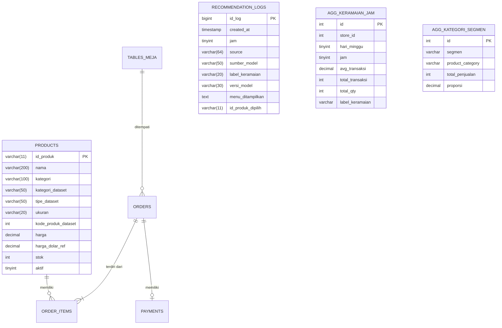

# DESAIN PERUBAHAN DATABASE PLAN B & RELASI (ERD / LRS)

Dokumen ini menjelaskan perubahan struktur basis data untuk mendukung migrasi ke dataset publik bertema coffee shop (Maven Roasters) pada sistem rekomendasi Warkop Bahagia.

---

## 1. Prinsip Desain
1. **Zero-Destructive**: Tidak mengubah atau menghapus data dan kolom yang sudah ada pada database utama.
2. **Kesesuaian Collation**: Seluruh tabel dan kolom baru memakai `utf8mb4_general_ci` untuk menghindari MySQL Error 1267 (Illegal mix of collations).
3. **Idempotensi**: Seluruh skrip SQL `database/planB/*.sql` dapat dijalankan berulang kali tanpa menghasilkan error atau duplikasi data.
4. **Isolasi Pengujian**: Diuji dan diverifikasi secara menyeluruh pada database `warkop_bahagia_test`.

---

## 2. Penambahan Kolom & Tabel Baru

### A. Tabel `products` (Penambahan Kolom Pelengkap Dataset)
| Kolom Baru | Tipe Data | Nullable | Deskripsi |
|---|---|---|---|
| `kategori_dataset` | VARCHAR(50) | YES | Nama kategori asli dari dataset (mis. Coffee, Tea, Bakery) |
| `tipe_dataset` | VARCHAR(50) | YES | Tipe produk dataset (mis. Barista Espresso, Brewed Chai Tea) |
| `ukuran` | VARCHAR(20) | YES | Ukuran porsi (Sm, Rg, Lg, none) |
| `kode_produk_dataset` | INT(11) | YES | ID unik produk dari dataset Maven (1 s.d. 80) |
| `harga_dolar_ref` | DECIMAL(8,2) | YES | Harga asli dalam satuan USD dari dataset |

### B. Tabel `recommendation_logs` (Penambahan Metadata Logging)
| Kolom Baru | Tipe Data | Nullable | Deskripsi |
|---|---|---|---|
| `sumber_model` | VARCHAR(50) | NO (Def: 'public_dataset') | Sumber rekomendasi ('public_dataset', 'fallback', 'sistem_sendiri') |
| `label_keramaian` | VARCHAR(20) | YES | Label estimasi keramaian saat log dibuat ('sepi', 'sedang', 'ramai') |
| `versi_model` | VARCHAR(30) | NO (Def: '2.0.0-planB') | Versi model ML yang menghasilkan log |

### C. Tabel Baru: `agg_keramaian_jam`
Menyimpan ringkasan statistik per jam untuk dasbor analitik admin:
```sql
CREATE TABLE `agg_keramaian_jam` (
    `id` INT(11) NOT NULL AUTO_INCREMENT,
    `store_id` INT(11) NOT NULL DEFAULT 0,
    `hari_minggu` TINYINT(4) NOT NULL,
    `jam` TINYINT(4) NOT NULL,
    `avg_transaksi` DECIMAL(8,2) NOT NULL DEFAULT 0.00,
    `total_transaksi` INT(11) NOT NULL DEFAULT 0,
    `total_qty` INT(11) NOT NULL DEFAULT 0,
    `label_keramaian` VARCHAR(20) NOT NULL,
    `updated_at` TIMESTAMP NOT NULL DEFAULT CURRENT_TIMESTAMP ON UPDATE CURRENT_TIMESTAMP,
    PRIMARY KEY (`id`),
    UNIQUE KEY `uk_store_hari_jam` (`store_id`, `hari_minggu`, `jam`)
) ENGINE=InnoDB DEFAULT CHARSET=utf8mb4 COLLATE=utf8mb4_general_ci;
```

### D. Tabel Baru: `agg_kategori_segmen`
Menyimpan proporsi penjualan kategori per 4 segmen waktu:
```sql
CREATE TABLE `agg_kategori_segmen` (
    `id` INT(11) NOT NULL AUTO_INCREMENT,
    `segmen` VARCHAR(20) NOT NULL,
    `product_category` VARCHAR(50) NOT NULL,
    `total_penjualan` INT(11) NOT NULL DEFAULT 0,
    `proporsi` DECIMAL(6,4) NOT NULL DEFAULT 0.0000,
    PRIMARY KEY (`id`),
    UNIQUE KEY `uk_segmen_kategori` (`segmen`, `product_category`)
) ENGINE=InnoDB DEFAULT CHARSET=utf8mb4 COLLATE=utf8mb4_general_ci;
```

---

## 3. Diagram Hubungan Entitas (ERD) & Struktur LRS



---

## 4. Hasil Verifikasi Database Uji
- Impor `01_schema_planB.sql`, `02_seed_katalog.sql`, dan `03_seed_agregat.sql` pada database `warkop_bahagia_test` berjalan 100% sukses tanpa error 1005, 1267, atau 1265.
- Uji idempotensi (eksekusi ulang berkas) berhasil tanpa duplikasi (total produk tetap 80 baris, total baris agregat keramaian tetap 406 baris).
- Uji `99_rollback_planB.sql` mengembalikan struktur tabel dan menghapus tabel agregat secara bersih.
- Checksum tabel basis data utama `db_warkop_bahagia` identik sebelum dan sesudah pengujian.
